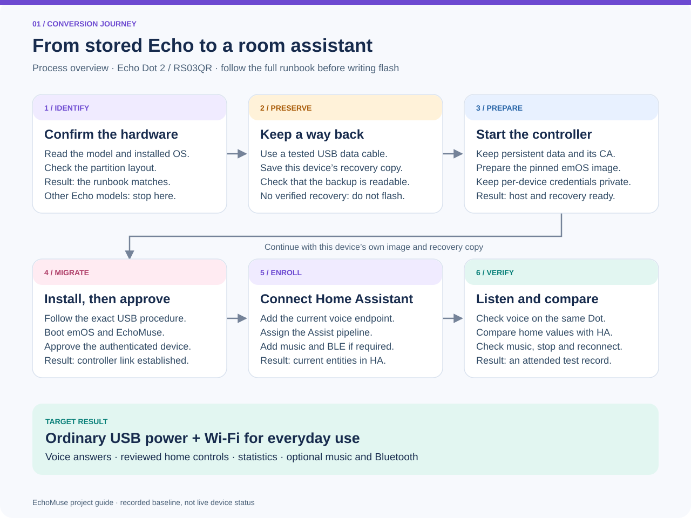

# ha-echomuse

[English](README.md) · [Русский](README.ru.md) · [Deutsch](README.de.md) · [Español](README.es.md) · [Français](README.fr.md)

Transformez un **Echo Dot 2** existant en satellite vocal Home Assistant avec
EchoMuse et emOS. Ce projet indépendant fournit un déploiement reproductible,
des procédures de récupération, des outils locaux pour la maison et une documentation
d’exploitation. Ce n’est ni une distribution officielle d’EchoMuse ni un micrologiciel universel pour tous les Echo.

[Documentation](docs/README.md) · [Exploitation](docs/operations.md) · [Compatibilité](docs/compatibility.md) · [Dépannage](docs/troubleshooting.md) · [Wiki](https://github.com/ha-homelab/ha-echomuse/wiki)

**[Guide visuel : processus et résultat](docs/visual-guide.md)** — conversion, parcours vocal, durées mesurées, rôles Bluetooth et vérifications. Le guide et les graphiques sont en anglais ; les connexions sont détaillées dans l’[architecture](docs/architecture.md).

## Fonctionnalités

- Préparation reproductible avec versions figées ; **le constructeur d’image ne flashe aucun appareil**.
- Assist via ESPHome, musique, annonces, minuteries, lecture avant la fin de la
  génération et interruption par phrase d’activation lorsque les composants le permettent.
- Outils Ollama locaux pour les états, le contrôle explicitement autorisé et les
  statistiques Recorder ; rapports d’énergie limités et en lecture seule.
- Un point d’accès Bluetooth proxy distinct et chiffré pour les appareils BLE.
- README en cinq langues et sélection de la langue de réponse dans une liste fixe.
  Des exemples natifs de consultation d’état sont fournis en anglais et en russe ;
  voir la [couverture linguistique](docs/i18n.md).

## Prérequis

La cible documentée est **Echo Dot 2 / RS03QR (biscuit)**. Vérifiez le modèle,
l’OS, les partitions et la sauvegarde propre à l’appareil avant de modifier le
démarrage. Les autres générations et les Echo grand format ne sont pas validés
par ce guide. Il faut une alimentation stable, un câble USB de données et un
hôte de récupération compatible ; le Wi-Fi seul ne suffit pas à restaurer le démarrage.

Home Assistant, une chaîne vocale Assist et EchoMuse Controller sont également
nécessaires. Music Assistant, Plex, Ollama et le service d’énergie sont facultatifs
selon les fonctions souhaitées. **N’appliquez pas les modèles de déploiement sans remplacer leurs valeurs d’exemple.**

## Ordre d’installation

1. Vérifiez la [compatibilité](docs/compatibility.md) et lisez tout le
   [guide de migration](docs/migration.md), y compris le retour arrière.
2. Déployez le [contrôleur](docs/controller.md) avec un stockage persistant privé,
   TLS et des identifiants distincts pour chaque appareil.
3. Vérifiez les [artefacts figés](upstream-lock.json), sauvegardez chaque appareil
   et préparez son image avec [build_emos.py](scripts/build_emos.py).
   Ne réutilisez jamais la sauvegarde d’un autre appareil.
4. Effectuez l’installation USB, approuvez l’appareil dans le contrôleur puis
   inscrivez son point d’accès vocal dans l’intégration **ESPHome** de Home Assistant.
5. Affectez la chaîne Assist, la langue STT et la voix TTS. Ajoutez au besoin
   les [outils domestiques](docs/home-control.md) et les [rapports d’énergie](docs/energy-assist.md).
6. Ajoutez les entités actuelles à [Lovelace](docs/dashboard.md).
   Inscrivez le [proxy BLE](docs/bluetooth-proxy.md) séparément.
7. Effectuez la [vérification de réception](docs/operations.md) de chaque appareil
   avant de migrer le suivant. Une connexion au contrôleur ne prouve pas qu’une réponse est audible.

## Au quotidien

Utilisez l’interface web authentifiée du contrôleur et sa root Console pour
l’administration : [accès et identifiants](docs/device-access.md). Le projet ne
crée pas de connexion SSH/Telnet universelle ; la récupération est traitée séparément.

Les deux Dot pilotes utilisent désormais **«Привет, Мышка»**, entraîné localement,
à la place de Hey Jarvis. Voir [entraînement, installation et limites des tests](docs/russian-wake-word.md).
Le micrologiciel utilise un seul modèle actif ; les poids personnels ne sont
pas inclus dans le dépôt.
Les [fonctions vocales](docs/voice-features.md) expliquent streaming et interruption.
Le [dépannage musical](docs/music-troubleshooting.md) couvre les sources absentes,
la mise en mémoire tampon, l’arrêt et la pause sur le lecteur d’origine.
**iBeacon Tracker** traite les annonces BLE ; ce n’est pas un proxy supplémentaire.

## Validation et limites

Base de tests documentée : emOS **0.10**, EchoMuse **2.18.0**, Controller
**2.26.0**, Home Assistant **2026.10.0**. Ce sont des versions testées à une date
donnée, pas les dernières versions garanties ni un état en direct des appareils.
Les deux migrations et des réponses russes à courte distance ont été vérifiées ;
la reconnaissance à distance et la fiabilité prolongée ont des limites. Voir le
[journal](docs/deployment-record.md), la [validation vocale](docs/russian-voice-validation.md)
et les [mesures de latence](docs/architecture.md).

La voix russe actuelle dans ce registre est **Silero Baya**. Les outils de la
maison utilisent Ollama localement, mais STT utilise FCC cloud speech : **la chaîne
complète n’est pas hors ligne**. Toute autre langue exige des réglages STT, modèle
et TTS compatibles et son propre test d’écoute. N’envoyez pas les données domestiques
à la voie cloud facultative des questions générales : [limites de confidentialité](docs/home-control.md).

## Contributions et documentation

[CONTRIBUTING.md](CONTRIBUTING.md) décrit tests et traductions,
[SECURITY.md](SECURITY.md) les signalements confidentiels, [CI](docs/ci.md) les
revues et le [guide Wiki](docs/wiki.md) la publication à partir de sources relues.
Enregistrements, modèles, identifiants d’appareils, clés, jetons et sauvegardes
restent privés. Les procédures détaillées sont maintenues en anglais.

## Sources et projets associés

- [EchoMuse](https://github.com/wilbowes/EchoMuse) : logiciel, contrôleur et emOS.
- [ha-echo-dot](https://github.com/ha-homelab/ha-echo-dot) : EchoLocal et entraînement d’activation.
- [ha-echo-show-5](https://github.com/ha-homelab/ha-echo-show-5) : procédure distincte pour Echo Show.
- [Infrastructure du dépôt](https://github.com/4alvit/terraform-github-ha-homelab) : Terraform.

Voir [LICENSE](LICENSE). Les composants amont gardent leurs licences ; aucun
micrologiciel Amazon, binaire de version ou modèle vocal personnel n’est redistribué.

[Réglages de voix russe et catalogue](docs/speech-settings.md) : cinq voix Silero, débit, hauteur, pauses et prononciation réglables dans HA. Le guide détaillé est en anglais.
