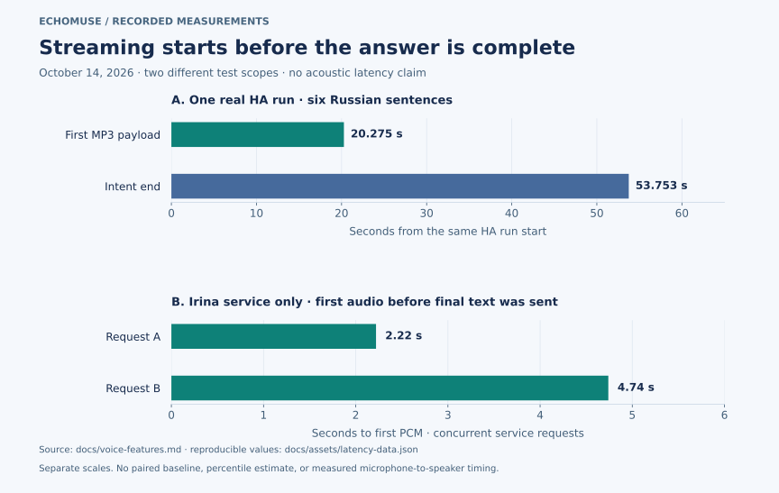

# Architecture and measured behavior

This project provisions and documents a deployment of upstream EchoMuse. It is
not a replacement firmware distribution and does not bundle Amazon firmware,
private model weights or credentials. The diagram describes the pinned baseline,
not every feature in later upstream releases.

## Text description of the architecture

**The physical Dot** runs emOS and EchoMuse device firmware. It owns the
microphones, speaker, LEDs and action button. The chosen openWakeWord model runs
locally; continuous microphone streaming is disabled in the recorded baseline.
The device connects to **EchoMuse Controller** over authenticated WSS.

**The controller** provides administration and an on-demand root Console. It
exposes a separate ESPHome voice listener for each Dot. **Home Assistant** uses
that listener to establish the voice satellite, native player and controls.
No HACS EchoLocal management component is needed for this connection.

**HA Assist** selects speech recognition, conversation and synthesis. Native
intents handle supported commands quickly. The local Ollama conversation agent
uses bounded home tools for discovery, state, reviewed controls and Recorder
statistics. The IGW energy adapter supplies deterministic snapshot reports.
Local Russian TTS uses **Silero Baya** by default through the Wyoming adapter. The
[settings integration](speech-settings.md) controls its five voices and prosody. In the
recorded configuration, speech recognition still uses FCC's cloud service;
the voice path is therefore not fully offline.

**Music Assistant** supplies the music queue, using the current native EchoMuse
player. Its HA queue entity is the preferred dashboard target. It is a different
path from TTS and from the older EchoLocal Sendspin integration.

**Bluetooth** is optional: the Dot receives BLE advertisements and the controller
exposes a distinct, encrypted ESPHome proxy endpoint. HA's Bluetooth integration
distributes those observations to consumers such as **iBeacon Tracker**. A
consumer integration is not another radio or proxy.

## Network boundaries

The diagram uses dashed lines to identify the configured external speech service.
Separate links have separate security properties:

- Device WSS uses the controller's CA and a per-device credential. Keep strict
  approval and require TLS after verified provisioning.
- The controller dashboard is HTTP on port 8768 by default. Use a trusted HTTPS
  endpoint or SSH tunnel when the access network is not trusted.
- The pinned controller's ESPHome **voice** listeners, starting at an allocated
  16001, have no Noise key. Restrict them to the HA path on the trusted network;
  WSS on the device link does not encrypt this separate connection.
- Optional **BLE** listeners have separate Noise encryption keys and allocated
  ports, normally the voice port plus 1000. Keep each key private.
- Wyoming's 10601 listener is restricted to the trusted service network. Its
  backend HTTPS connection uses the speech service's private CA and bearer
  credential. Do not expose plaintext internal listeners to the Internet.

Port allocation, mDNS and certificates are detailed in [controller hosting](controller.md).
Do not infer trust merely from a hostname ending in an internal DNS suffix.

## Measured streaming behavior

For the request stages and a single-run timeline, see the
[illustrated process guide](visual-guide.md#3-what-the-timing-measurements-actually-show).

The upper plot uses one real HA run with six Russian sentences. The client
received the first MP3 payload at **20.275 seconds**, while `intent-end` arrived
at **53.753 seconds** from the same run start. Audio delivery overlapped later
generation by **33.478 seconds**. This derived interval is **not** a measured
speedup against a non-streaming run; no paired baseline was recorded.

The lower plot is a different test: two concurrent requests to the real Irina
streaming service delivered first PCM at **2.22** and **4.74 seconds** before the
test sent their final sentences. It excludes microphone capture, recognition,
the language model, HA delivery and speaker playback. The different starting
points mean these two plots must not be added or compared as alternatives.

Neither test establishes sound heard in the room, far-field accuracy, percentile
latency or a service-level objective. The larger model's first-sentence delay
remains visible. Original evidence is in the [voice feature record](voice-features.md#deployment-checks--october-14-2026).
The public [figure data and rendering recipe](assets/README.md) contain only
aggregated timings and no transcripts, device identifiers or recordings.

## Failure isolation

A wake light means the device detected a trigger. It does not establish an HA
connection, a correct transcript, a valid tool action or audible output. Diagnose
the first failed stage: power/Wi-Fi → authenticated controller → HA voice
connection → STT → intent/conversation → TTS fetch → device playback.
Music source failures and BLE consumer discovery have their own branches.
Use the [troubleshooting guide](troubleshooting.md) instead of changing all
layers at once.
