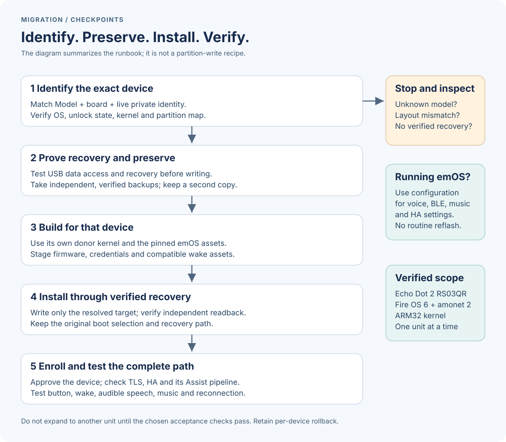

# Hardware and feature compatibility

Compatibility is a combination of **model, unlock state, kernel architecture,
partition layout and software version**. The model label alone does not prove
that a particular installation command is safe.

## Hardware scope

The verified hardware in this repository is **Echo Dot second generation,
model RS03QR, board biscuit**, already unlocked and running EchoLocal on
**Fire OS 6 / Android 7.1.2 / SDK 25** after amonet 2. Both units were migrated
individually with their own kernel, partition checks and recovery images.

Read the underside **Model** field; do not confuse it with a production code,
serial number, friendly name in Alexa, or a ring color. Keep serial numbers out
of public reports. Once USB recovery is working, corroborate the model with
the board, OS and partition inventory. A powered USB cable is not proof of a
working USB data channel.

An Echo Dot of another generation, a full-size Echo, Echo Plus, Echo Show or
Echo Studio is outside this repository's verified migration scope. A full-size
Echo carrying another model code is not made compatible by looking similar or
by reaching an Android recovery shell. Upstream may support additional models
through different procedures; consult its [pinned rooting guide](https://github.com/wilbowes/EchoMuse/blob/e119433c0845dfe80f4b1ec44c9e8e8028adbb07/docs/rooting.md)
and the [EchoLocal project](https://github.com/ha-homelab/ha-echo-dot) before
planning a separate investigation. This guide deliberately does not turn
unverified models into a shopping recommendation.

## Installation decision

1. **Already running the pinned emOS/EchoMuse stack?** Use ordinary controller
   and HA configuration. A change to Russian speech, music routing or BLE
   enrollment does not require another flash.
2. **Verified RS03QR on the documented Fire OS 6 / amonet 2 path?** Use the
   [emOS migration runbook](migration.md), including USB recovery and per-device
   backup verification before any write. The retained kernel is ARM32 in this
   deployment; the builder checks the supplied boot image.
3. **Fire OS 5 or a different unlock/layout?** The upstream in-place FireOS
   installer is a separate route. This repository did not validate it on these
   units. Do not bypass its refusal checks or substitute this runbook's block
   devices and slot choices.
4. **Unknown model, mixed OS partitions, no verified recovery or no readable
   escrow?** Stop before partition writes. Identify and resolve that condition
   first. A failed check is not a reason to force an older installer.

Wrong images can fail to boot, lose Wi-Fi or audio, overwrite the wrong slot or
destroy the recovery path. A same-model neighbour's prepared image is not a
substitute for the target's own donor kernel and backups. emOS automatic recovery
cannot rescue a kernel or init that never starts.

## Software and feature scope

For the recorded **Controller 2.26.0 / device 2.18.0 / emOS 0.10** baseline:

- One active openWakeWord model is advertised to HA. Supplied alternatives
  include **Hey Jarvis**, **Alexa**, **Hey Mycroft** and **Hey Rhasspy**. An empty
  second HA selector is not a license restriction or a missing “extended” edition.
- EchoLocal's personal microWakeWord TFLite model is not an EchoMuse ONNX model.
  Converting the speaker does not transfer custom wake accuracy. Train and
  evaluate a compatible model separately, using held-out positive and negative
  recordings before adjusting thresholds.
- Russian speech is supplied by HA's pipeline and the installed Irina model.
  It does not require a Russian wake phrase. Documentation translations do not
  change device firmware languages or install speech models.
- Streaming answers, wake-word barge-in, cue, announcements and timers are
  documented in [voice features](voice-features.md). Timers require HA and
  connectivity; they are not standalone offline alarms.
- BLE advertisement forwarding and optional active connections use a separate
  proxy enrollment. This does not implement Bluetooth Classic/A2DP pairing.
- The network root Console is on the controller. emOS uses a USB serial console;
  the installed system has no Android ADB daemon and no configured SSH service.

Upgrades can change these limits. Review release notes and pinned source,
preserve a known-good image/configuration, then validate one physical unit before
changing the second. Do not describe a newly advertised feature as deployed
until its configuration, protocol and acoustic checks have passed.
