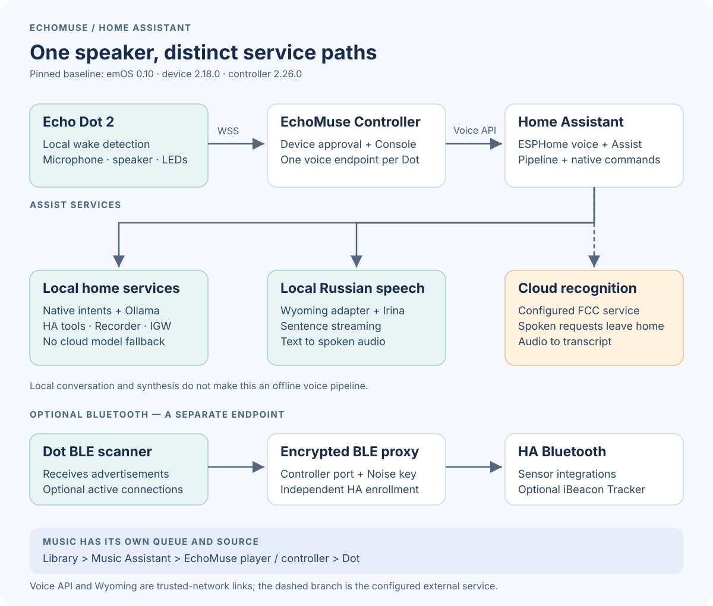
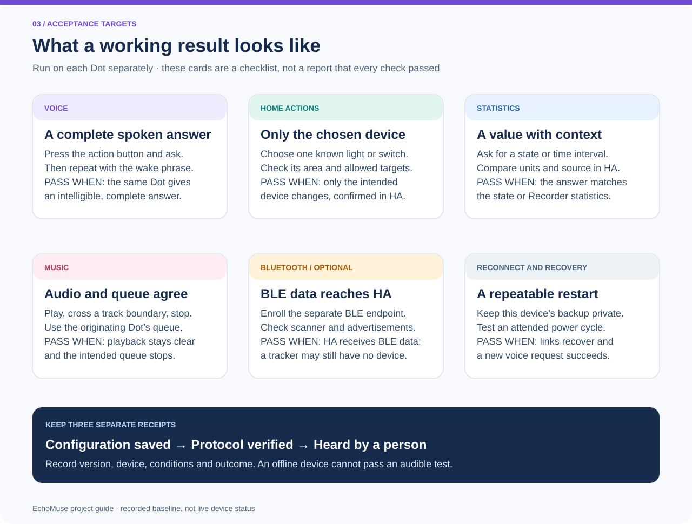

# Operations handbook

Use this handbook after a successful migration. It connects the configuration
screens, service dependencies and checks that are otherwise spread across the
runbooks. The recorded baseline is **emOS 0.10, EchoMuse firmware 2.18.0 and
Controller 2.26.0**. It is a deployment record, not a claim that these are the
latest upstream releases or that both devices are online now.

The [visual process and result guide](visual-guide.md) shows the full journey,
request path and acceptance targets before you work through these steps.

## Start with the right layer

The Dot handles physical audio and local wake detection. The controller links it
to HA. HA selects recognition, conversation and synthesis services; Music
Assistant handles music queues. Read the [architecture guide](architecture.md)
for a text equivalent of the diagram and the network boundaries.

For normal use, each Dot needs stable USB power and Wi-Fi. It does **not** need
to remain plugged into Synology. Use a tested USB data cable and the verified
recovery host for OS migration or recovery; power-only operation and a working
data connection are different checks.

## Service startup and enrollment order

1. Start the controller with its existing persistent data, CA and device
   approvals. Check the dashboard and the device's authenticated TLS connection.
2. Start Home Assistant and verify each current **ESPHome voice** entry, using
   the controller address and that Dot's assigned voice port. The old EchoLocal
   host, port and encryption key are not the EchoMuse endpoint.
3. Verify the configured speech-recognition provider, the local conversation
   service, and the local Russian speech service. Add the latter through
   **Wyoming Protocol** in HA, then verify actual audio generation.
4. Under **Settings → Voice assistants**, select **Local Russian Home**, Russian,
   the local conversation agent, the intended recognition provider and
   `tts.local_russian_speech` with `silero-ru-default`. Keep local intent handling
   enabled. Read back both Assistant selectors when a device exposes two.
5. In Music Assistant, select each current native EchoMuse player in the
   **Home Assistant MediaPlayers** provider. Use its MA queue entity for the
   dashboard and origin-based music routing. Preserve other room selections.
6. Add an optional, separate **ESPHome Bluetooth proxy** entry with the assigned
   BLE port and Noise encryption key. Voice enrollment does not enroll BLE.
7. Update the existing Lovelace media view using [verified entity mappings](dashboard.md).
   A dashboard card cannot repair a disconnected controller or device.

Use the [controller runbook](controller.md), [Russian speech operations](russian-voice-operations.md)
and [home-control guide](home-control.md) for the detailed installation steps.
Home Assistant Container needs these external services; this repository does not
assume a Supervisor add-on store.

## Change the intended setting

- **Wake phrase, cue, barge-in, audio processing and BLE:** per-device EchoMuse
  configuration. Save all unrelated effective values and section overrides.
  Current support is one active wake model. The baseline is **Hey Jarvis**.
- **Voice language and voice persona:** HA's selected Assist pipeline and the
  speech server's installed model. Changing display language or a prompt does
  not install a Russian voice. The current Baya service exposes five Silero
  speakers through [live settings](speech-settings.md).
- **Device control and statistics:** the local conversation integration,
  reviewed control list, HA areas/aliases and Recorder data. Say a native
  command first to isolate configuration from model latency.
- **Music selection and volume:** Music Assistant and its queue player. A
  successful spoken acknowledgement is not proof that a stream is audible.
- **Dashboard presentation:** Lovelace. Use one section per physical Dot,
  with its MA player and current voice controls; omit the unsupported second
  wake selector.

Do not copy the old «Привет, Мышка» microWakeWord TFLite model into EchoMuse.
A custom openWakeWord ONNX model needs its own held-out recordings, false-wake
measurement and device evaluation. Read [compatibility](compatibility.md).

## Privacy boundary

Local wake detection, the local household model, local tools and local Silero
synthesis do not make the entire voice path offline. The recorded pipeline
still uses **FCC cloud speech recognition**: spoken requests leave the home for
transcription. The separate external Nemotron route is only for general
questions without household or confidential data, never an automatic fallback
for home control. Migrating recognition to a local server is separate work.

Keep recorded voices, model outputs trained from them, identities, tokens, Wi-Fi
configuration and recovery images in private storage. Do not enable continuous
recording to investigate a routine service failure. Treat console output and
nearby Bluetooth inventories as private diagnostic data.

## Acceptance after a change

These are test targets, not a live dashboard. The
[text equivalent](visual-guide.md#4-verify-the-result-feature-by-feature)
explains what to observe in each area.

Record the version, time, changed layer and rollback before testing. Test one
Dot, then repeat on the other; saved settings on an offline Dot are pending.

1. Press the action button and ask «Сколько будет два плюс два?»; listen for a
   complete answer on that same Dot. This bypasses wake detection.
2. Say **Hey Jarvis**, wait for feedback, then ask a short question. Repeat from
   the intended location and record background conditions and misses.
3. Ask a read-only home question and compare the result with HA. Test a
   deliberately chosen light action separately; inspect room membership first.
4. Say «Играй музыку», listen through a track transition, then **Hey Jarvis**,
   wait, and say «Стоп». Verify the intended queue stops.
5. For voice features, test a long answer, wake-word interruption, an
   announcement and a short attended timer. Cancel or dismiss test timers.
6. Check reconnection after ordinary power cycling only when someone can verify
   the result. Do not interpret a retained selector value as proof of life.

Log **configuration saved**, **protocol verified** and **heard by operator**
separately. The [latency figure](architecture.md#measured-streaming-behavior)
illustrates why server measurements are not acoustic guarantees.

## Backup, cleanup and rollback

Back up the controller's consistent database, its sidecars, CA and settings;
HA integration configuration and dashboard mappings; per-device recovery images;
and the original effective settings before changing them. Keep backups private
and test readability. A fresh controller CA does not preserve existing trust.

After replacement entries work, obsolete EchoLocal integrations can be removed
through HA's supported interface. Preserve private recovery information first
and check scripts, automations and cards for references. There is no benefit in
retaining dead scanners indefinitely. Removal does not flash or erase the Dot.
The recorded cleanup removed two obsolete ESPHome entries and their two
Bluetooth entries; [Bluetooth notes](bluetooth-proxy.md) explain the result.

Rollback the smallest changed layer: pipeline selection, queue setting,
controller configuration or matching service image. Firmware rollback is the
separate [USB recovery procedure](migration.md#roll-back-to-echolocal). If its
old HA entry was deleted, re-enroll it using the private preserved configuration
and repair entity references before testing. Do not restore a whole shared HA
configuration merely to undo one speaker setting.
