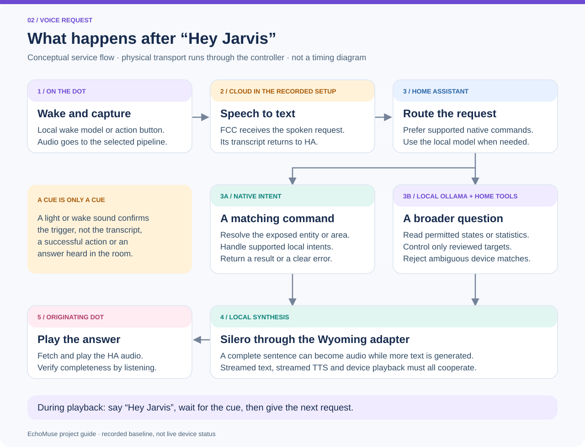
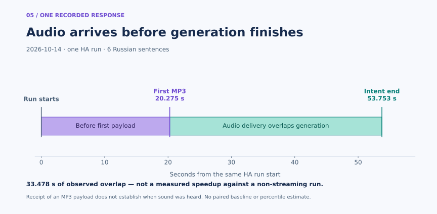
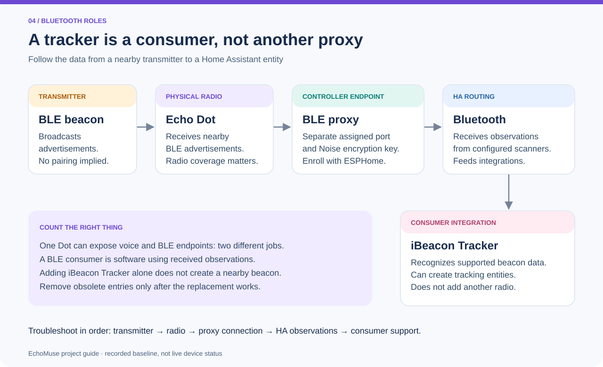

# From an old Echo to a working Home Assistant satellite

This illustrated guide connects the **process**, the **result you should check**,
and the runbook for each part. Its scope is the documented Echo Dot 2 / RS03QR
conversion, using the recorded emOS 0.10, EchoMuse 2.18.0 and Controller 2.26.0
baseline. It is not a live dashboard or a new hardware compatibility claim.

The diagrams use numbered steps and written labels as well as color. Purple
marks device or model work, blue marks HA or controller coordination, teal marks
local services, and amber calls out recovery or an external boundary. Color
never represents a device being online or a test having passed.

## 1. The conversion journey

1. **Identify the unit.** Read the model, installed OS and partition layout.
   The output of this step is a confirmed match to the
   [compatibility guide](compatibility.md). An unsupported model stops this
   procedure; similar branding or a USB connector does not establish support.
2. **Preserve recovery.** Use a tested data cable and keep a readable backup
   belonging to that specific unit. The output is a recovery path, not just a
   copied filename. Keep the image and credentials outside the public repo.
3. **Prepare the controller and image.** Start the
   [controller](controller.md) with persistent data and its CA, then prepare
   the pinned image. The builder prepares artifacts; it does not flash a Dot.
4. **Migrate over USB, boot and approve.** Follow the complete
   [migration procedure](migration.md), including its stop conditions. The
   first result is an authenticated device connection in the controller.
   That connection alone does not prove that HA or audio playback works.
5. **Enroll the new HA endpoints.** Add the current ESPHome voice endpoint,
   select the Assist pipeline, and add optional music and BLE separately.
   Update [Lovelace](dashboard.md) to the current entities. An old EchoLocal
   entry is not the new EchoMuse connection.
6. **Verify the user-visible result.** Listen to the same Dot answer, compare
   a home value with HA, and check optional features separately. Repeat the
   checks on the next physical unit; do not copy another unit's recovery image.

**Everyday result:** the Dot can run from ordinary USB power and Wi-Fi. A USB
data connection to the recovery host is needed for migration or recovery, not
for routine voice use. The expected capabilities are HA voice, permitted home
controls and statistics, with music and BLE available when separately configured.
Use the [operations handbook](operations.md) for the exact service startup order.

## 2. Follow one spoken request

The paths in this illustration are conceptual service stages. The controller
carries the device connection; its transport is shown in the
[network architecture](architecture.md), not repeated for every arrow here.

1. **Trigger:** the Dot detects its local wake model, or the action button starts
   the request. The cue confirms this trigger only.
2. **Recognition:** the selected STT provider converts captured speech to text.
   The recorded setup uses **FCC cloud recognition**, so this stage sends the
   spoken request outside the home. Local wake detection and local TTS do not
   make the complete pipeline offline.
3. **Routing:** HA prefers matching native intents. A broader home question can
   use the local Ollama agent and [bounded home tools](home-control.md).
   Entity exposure, user permissions, the control allowlist and ambiguity
   checks still apply. A broad question does not grant unrestricted control.
4. **Synthesis:** local Irina speech through the Wyoming adapter turns complete
   sentences into audio. With compatible streaming at every stage, synthesis
   can begin before all answer text is available.
5. **Playback:** the originating Dot fetches and plays the answer. Listen for
   completeness; a generated audio URL or successful service call is not proof
   that the speaker was heard.

During playback, say **“Hey Jarvis”**, wait for feedback, then speak the next
request. A music stop command must reach that Dot's music queue; stopping TTS
and stopping a Music Assistant queue are different operations. See
[voice features](voice-features.md) and [music troubleshooting](music-troubleshooting.md).

## 3. What the timing measurements actually show

This is a **graph of recorded events**, not a promised response time. In the
October 14, 2026 six-sentence HA run, the first MP3 payload arrived at
**20.275 seconds** and `intent-end` arrived at **53.753 seconds**. The derived
overlap is **33.478 seconds**. It shows that audio delivery and later generation
overlapped in this run; it does not measure a speedup against a non-streaming run.

The first interval includes everything before the measured first payload. It
cannot be split into recognition, model and synthesis costs from these two
timestamps. Neither timestamp establishes when a person first heard the Dot.

The [separate service measurements](architecture.md#measured-streaming-behavior)
recorded first PCM at 2.22 and 4.74 seconds for two concurrent Irina requests.
Those are a different experiment and must not be added to, or substituted for,
this HA timeline. Raw aggregate values and rendering instructions are in the
[figure source guide](assets/README.md).

## 4. Verify the result, feature by feature

These cards describe **pass conditions**, not newly completed tests:

- **Voice:** ask «Сколько будет два плюс два?» using the action button, then
  repeat using the wake phrase. A pass means a complete, intelligible answer
  from the intended speaker. Record distance and background noise separately.
- **Home actions:** choose one known light or switch, inspect its area and
  allowed targets, and compare the actual state in HA after the command.
  Only the intended device should change.
- **Statistics:** compare a current reading or a named historical interval
  with its HA source. The answer needs the correct unit and interval; a current
  counter is not automatically consumption during the requested period.
- **Music:** play on the originating Dot, listen through a track change and
  stop its queue. A spoken acknowledgement without audible playback is not a
  pass. A missing library file is distinct from a buffering problem.
- **Bluetooth:** verify the separate proxy connection and received
  advertisements. A consumer integration can be configured yet have zero
  supported nearby devices; this alone does not establish a proxy failure.
- **Reconnect and recovery:** retain the per-device recovery material and
  conduct an attended ordinary power cycle. Confirm reconnection and a new
  audible request. A saved selector value is not a connectivity check.

For every attempt, record three different outcomes: **configuration saved**,
**protocol verified**, and **heard or observed by a person**. Do not convert an
unperformed or offline test into a success. Existing historical observations
remain in the [deployment record](deployment-record.md) and
[Russian voice validation](russian-voice-validation.md); this guide adds no new
attended test results. The [troubleshooting guide](troubleshooting.md) maps
failures to the first layer to inspect.

## 5. Read the Bluetooth chain correctly

A nearby transmitter broadcasts advertisements. The Dot's radio receives
them. The controller makes them available through a separate encrypted ESPHome
BLE endpoint, enrolled in HA independently of voice. HA Bluetooth then supplies
observations to compatible integrations such as **iBeacon Tracker**.

This is why a voice entry, a BLE proxy and iBeacon Tracker are not three physical
Bluetooth radios. iBeacon Tracker consumes supported beacon data; adding it
does not manufacture a nearby beacon or a tracking entity. Start diagnosis at
the transmitter and radio, then check proxy connectivity, HA observations and
consumer compatibility in that order. Keep nearby identifiers private. The
[Bluetooth runbook](bluetooth-proxy.md) covers enrollment and obsolete-entry
cleanup after the replacement has been verified.

## Maintain these figures

The diagrams are editable, source-only SVGs; their text equivalents are the
sections above. The timeline is rendered with matplotlib from existing public
measurements. Neither renderer queries HA, records audio or reads credentials.
See [sources and reproduction](assets/README.md). README navigation in English,
Russian, German, Spanish and French points to this English technical guide.
